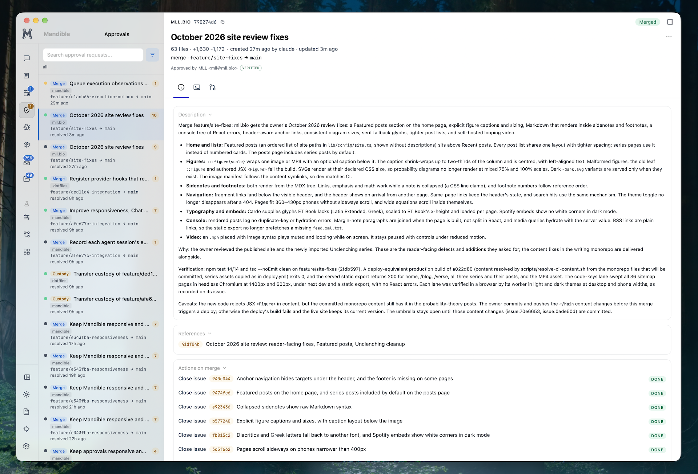

<p align="center">
  
</p>

# Mandible

Mandible is an operations manager for AI agents. It consists of:

1. A daemon that manages a ledger: issues, work units, user approvals, annotatable briefings, and an index of agent conversations. 
2. A CLI that allows agents to interact with the ledger. 
3. A web and desktop app where the user can interact with the ledger, as well as review conversations.
4. Integrations that connect Claude Code, Codex, and Gemini to the ledger: lifecycle hooks, an MCP channel server, and Chat.

## Feature highlights

- **Approval-gated merges**: agents submit merge requests with a change message; you approve with your hardware signing key, the merge commit is signed with that key, and issue closures and post-merge hooks follow.
- **Structured issues**: kinds, priorities, typed relationships, checkpoints outside the comment stream, working notes, full revision history, and keyword search.
- **Umbrella issues** for coordinating lanes of agent work, with a delegation manifest that reports what changed since the coordinator last looked.
- **Work units** join an issue, a branch, and the agent on it; a stopped agent's work can be taken over, a live agent's never.
- **Every conversation indexed** as it is written, across Claude Code, Codex, and Gemini: search, star, tag, annotate, export; parent and child sessions linked.
- **Sessions without registration**, with live, stopped, or unknown liveness, and terminal navigation when a process is attached.
- **Briefings**: present a document for annotation in the app, submit the annotations as a round, and promote a proposed update to the base when its merge is approved.
- **Artifacts**: versioned files with Git or managed custody, cited from issues.
- **Chat**: run and follow Claude Code and Codex conversations from the app, with permission prompts, usage, attachments, resume, and fork.
- **Reminders** that post to the inbox at a time, when an issue closes, or when a merge count is reached.
- **Spaces, Timeline, and Graph** to organize, chronologize, and relate ledger entities.
- **Reversible branch cleanup**: merged branches go to trash custody and can be restored, ignored files included.
- **Sandboxed agents** reach the ledger through a file spool when they have no network access.
- **Self-updating**: Mandible merges its own changes only after automated candidate acceptance, then hands the running daemon over to the new build.



## How it fits together

| Part | What it does |
|---|---|
| Daemon (`src/`) | A Bun process serving the HTTP API, Server-Sent Events, WebSocket terminal I/O, and the app from one port. It runs ingestion, the auth queue, the work-unit reconciler, the session reaper, reminders, and backups. |
| CLI (`bin/mandible`, `cli/`) | Shell scripts over the daemon API. Local calls use the owner-only Unix socket `~/.cache/mandible/local-api/production.sock`. A sandboxed agent with no loopback access sets `MANDIBLE_BASE=file:///path/to/spool` instead: the daemon watches the spool under `~/.cache/mandible/agent-rpc/`, answers request files in place, and serves ledger reads and writes, auth submission and listing, and work-unit mutation over it, never approval, merge, or admin routes. |
| App (`ui/`, `src-tauri/`) | A Preact single-page app served by the daemon at `https://app.mandible.localhost:19420`, optionally wrapped in a Tauri macOS window that also controls the launchd services. |
| Channel server (`channel-server/`) | An MCP server that gives a running Claude Code session Mandible tools and notifications. |
| Hooks (`hooks/`) | Claude Code lifecycle hook scripts that attach a process to its session, and a Git `reference-transaction` guard for protected branches. |

The daemon's loopback backend port is `29420`; browsers and the desktop reach it through the HTTPS front door at `app.mandible.localhost:19420`. See [Architecture](docs/concepts/architecture.mdx) and [Real-time events](docs/concepts/real-time-events.mdx).

## The ledger

Entities are referenced by short id with a kind prefix, as in `issue:58e452e`, `auth:bb4c211`, or `artifact-version:1a2b3c4d`. In authored Markdown, `[issue:<id>]`, `[issue:<id>#<n>]`, `[auth:<id>]`, `[briefing:<id>]`, and the artifact forms resolve to links; only `[issue:...]` references are recorded as relationships. Every entity has a web link, `https://app.mandible.localhost:19420/<kind>/<ref>`; links with `/r` before the kind redirect to the desktop app.

### Issues

An issue belongs to a project (a registered repository) and has a kind (`bug`, `feature`, `umbrella`, `experiment`, `tracker`, `maintenance`), a priority (`low`, `normal`, `high`, `urgent`), free-form labels, and an open or closed status; closing requires a resolution (`delivered`, `duplicate`, `wontfix`). Bodies, comments, and working notes keep every revision. Relationships (`parent_child`, `blocks`, `duplicate_of`, `related`, `references`, `fixed_by`, `caused_by`, `implements`, `tests`) are structured edges, not prose. Checkpoints hold kind-tagged structured state outside the comment stream; a worker's closeout checkpoint carries its status, branch, blockers, and next action.

An umbrella's membership is its `parent_child` edges. `mandible umbrella status` prints a coordinator's fact packet, and `mandible issue changed --since-issue` says which children changed since the last delegation manifest, including changes below nested umbrellas. The parent role records which session is coordinating.

```bash
mandible issue new -t 'Title' -m 'Body' --kind feature --priority high
mandible issue search <words>...           # titles, bodies, comments; all projects
mandible issue report <id> --json          # deterministic context for a handoff
mandible issue comment add <id> -m 'Markdown with real newlines'
mandible issue close <id> --resolution delivered
mandible umbrella adopt <umbrella> <children>...
mandible db query "select kind, count(*) from ledger_issues group by 1"
```

[Issue tracking](docs/features/issues.mdx) describes the app view; `mandible db` reads the live database read-only for anything the structured commands do not cover.

### Work units

A work unit joins one issue, one branch in one repository, and the session attributed to it, through the states `open`, `committed`, `resolved`, and `abandoned`. Work units are the source of an issue's branches and of its in-progress state; the reconciler detects commits, abandoned branches, and dead holders, and resolves units when their merge lands.

Each unit has a durable custodian (the credential that claimed it) and a recorded session. Within one credential the recorded session holds the unit; `custody-check` reports `clear`, `held`, or `takeover_available`, and `custody-assume` transfers a stopped holder's unit with a generation receipt. A live holder, or one whose liveness is unknown, refuses.

The worktree tool is policy, not Mandible, but the reference flow is `wt new feature/<name> --issue <id>`, which claims the unit and writes the git-root `.issue` file that `commit-linked` reads. `cli/ledger-client.sh` is the sourceable policy-free client for such wrappers. See [Work units](docs/concepts/work-units.mdx).

### Approvals

An approval request (auth request) is how an agent asks for an operation it may not perform itself: a merge into a protected branch, or an explicit command reviewed under one of the types `commit`, `force-push`, `branch-delete`, `config-change`, `data-delete`. Submission is asynchronous and never runs the operation.

```bash
mandible auth list --head feature/x                       # find an existing request first
mandible auth check --branch feature/x --repo <repo>      # clean against the target and the queue?
mandible auth request feature/x --title 'Merge feature/x: outcome' \
  --closes-issue <id> --message-file change.md \
  --verification 'bun run test passes' --no-watch
```

A merge request binds to one committed, issue-linked work unit owned by the submitting credential. The daemon runs a read-only merge preflight against the target and against every queued request for the same target, so independent branches queue together and a conflicting one is refused with the clashing files. Issue references and closures are structured fields on the request, never commit-message prose.

**Change message.** Every merge request carries one canonical change message: the agent writes the outcome, a `Why:` paragraph, and optional `Caveats:` for anything to be done by hand after the merge; the CLI adds the subject prefix and the `Verification:` section. The daemon stores the exact bytes and their digest, freezes them after approval, and commits exactly those bytes.

**Approval and execution.** Approving verifies a fresh signature from an active operator credential over the exact reviewed request; a hardware-backed key needs its physical touch. The merge then builds the signed commit from the reviewed tree and parents before touching the protected ref, with the agent's signing overrides stripped from the environment. The protected base is audited back to the newest recorded Mandible merge, and commits that are neither Mandible merges nor operator-signed are listed on the request. Merged branches go to reversible trash custody (`mandible trash`), which keeps a worktree's unique bytes, including ignored files.

Pending requests can be withdrawn by their requester or atomically superseded by a replacement that carries or disposes of every staged action. A later merge that makes a queued request conflict moves it to `needs_rebase`. Results reach the submitting session through SSE and the inbox.

#### Approval hooks and convergence

Operator-registered hooks run after a successful operation, matched by repository pattern and request type, in a scrubbed allowlist environment. Each execution is recorded before it starts with the exact command bytes, retried up to three times, and never reruns the merge. A request therefore reports convergence as `complete`, `pending`, or `failed`; a failed required hook withholds the deferred issue closures until it succeeds. Registering a hook needs the `change_settings` capability. See [Auth queue](docs/features/auth-queue.mdx) and [Approvals end to end](docs/guides/auth-workflow.mdx).

#### Clearances and the branch guard

A clearance is an operator-issued, bounded grant that lets one agent credential execute one scoped protected merge. The Git `reference-transaction` hook in `hooks/git/` refuses any update to a protected branch that is not an approved Mandible merge or an operator-signed commit; see [Protected-branch guard](docs/protected-branch-guard.md).

#### Updating Mandible itself

A merge request for this repository is approvable only after the daemon has built and smoke-tested the exact candidate merge ([candidate acceptance](docs/candidate-acceptance.md)). The post-merge rebuild hands the running daemon over to the new build through a journaled lock ([runtime handoff](docs/runtime-handoff.md)); a failed handoff leaves the old runtime live and the evidence intact.

### Artifacts

An artifact is a durable file record with versions. Each version has one custody: `git` (a verified commit, path, and hash in a registered project, with the commit retained under `refs/mandible/artifacts/`) or `managed` (bytes stored by Mandible). An artifact has at most one current source, which can be moved while keeping its history. Link an artifact to an issue as references, output, evidence, or handoff, pinned to a version or following the latest.

```bash
mandible artifact ingest docs/design.md --project <key> --commit <sha> --issue <id>
mandible artifact show artifact:<id>
```

[Artifact CLI](docs/artifact-cli.md) and [Artifact identity and custody](docs/artifact-identity-and-project-associations.md) have the rules.

### Briefings

A briefing presents one artifact version for review. The operator annotates it in the app and submits the annotations as a round; agents read the submission and act. Briefings are grouped into ordered bundles, and a group pairs a base bundle with proposed updates: a proposal becomes the base through a promotion staged on the merge request that lands its bytes (`--promote-briefing`), or through the operator's own accept. Recurring reports publish through authenticated routes rather than proposals.

### Conversations and sessions

The daemon watches `~/.claude/projects/`, `~/.codex/sessions/`, and `~/.gemini/tmp/`, parses each transcript into typed blocks, and stores them compressed. The provider's file remains the veridical record; `mandible logs inspect` reads it directly, and `mandible conversations` reads the index.

```bash
mandible conversations search "auth request" --provider claude --since 7d
mandible conversations show <id|session-id> --blocks
mandible conversations star <ref>; mandible conversations tag add <ref> <tag>
mandible conversations comment <ref> -m 'note'
```

Star, tag, and comment are Mandible's own metadata, kept apart from the provider's title. Custody of the provider-native bytes is separate from the index; see [Conversation custody](docs/conversation-custody.md).

**Identity.** A session is identified by its provider session id: a Claude session or subagent id, a Codex thread id, a Gemini session id. Its durable record is its indexed conversation; nothing else is required for it to appear, to be linked to an issue, or to hold a work unit. A `sessions` row is an optional process attachment, pid, terminal and multiplexer navigation, kill, created by Claude's lifecycle hooks and by Mandible's own launches. Every surface that takes a session (the overview, `mandible session link-issue`, work-unit holders, `--session` on the parent role) accepts a provider session id, a Claude subagent's agent id, a console session id, or a session row id, and none creates a row; `mandible issue parent-role assume` defaults to the caller's own provider session id.

**Liveness.** One rule answers `live`, `stopped`, or `unknown` for any alias: a process row's status, a console session's status, or Codex's own thread-writer lock. A check that cannot complete is `unknown`, and the reconciler, archival, custody, and the parent role all defer behind it. Work-unit and inbox payloads carry the same tri-state.

**Lineage.** `conversations.parent_conversation_id` is the one lineage store, written only by ingestion. A subagent's parent comes from the provider's own record. Every other child declares its parent on line 1 of its first user message:

```
[mandible child parent=<provider>:<session-id> parent-role=<role> role=<role>]
[mandible successor predecessor=<provider>:<session-id> role=<role>]
```

A provider's creator record (a Codex `create_thread` delegation envelope) outranks the marker for who created the thread; the marker supplies the relation and roles. A child is linked whichever of parent and child arrives first. `mandible conversations lineage-gaps` lists children without a trustworthy parent: a malformed marker, an unindexed parent, a marker that disagrees with the creator record, or an agent-created thread with neither. The contract's "Session Lineage" section is the grammar's one definition.

**Overview.** `GET /api/sessions/<ref>/overview` serves every provider from one summary of a session: facts from its indexed conversation, liveness from the rule above, and its process attachment when one exists. Children come from lineage, keyed by the child's own provider id (a subagent by its agent id), bounded in depth and count; work units are matched across the session's and its descendants' ids. A prefix naming several sessions answers with the candidates. Issue session lists read sessions through the same summary, so a linked Codex thread shows its provider and liveness.

**Codex worker threads.** A unit bound with `mandible work-unit activate --worker` has its Codex thread archived by the reconciler once the unit resolves by any path and the thread is stopped, never held a parent role, and holds no other open or committed unit. A resume dispatch unarchives the thread first.

### Reminders

`mandible reminder create` arms a durable one-shot reminder that posts to the inbox when a time arrives, an issue closes, or a project's completed-merge count reaches a threshold; idempotency keys make retries safe.

## The app

The app's views, in rail order:

- **Session**: one page per session of any provider, opened by any of its ids or a prefix of one: its facts and liveness, its process attachment when it has one, its child sessions from lineage with their liveness, linked issues, work units, and conversations. Chat's right sidebar shows the same page for the open conversation.
- **Chat**: start and follow conversations with Claude Code (through the Agent SDK) and Codex (through its app server): permission prompts, usage and context, attachments, resume, and fork. Ownership of a live conversation is a separate fact from observing its transcript.
- **Timeline**: a project's issues, comments, relationships, and ledger events on one global time axis.
- **Approvals**: the queue and history, with the diff, change breakdown, protected-base audit, hook output, convergence, and staged issue actions for each request.
- **Issues**, **Artifacts**, **Briefing**, **Inbox**: the ledger surfaces above. The inbox collects continuations, approval results, and open issues for a branch.
- **Spaces**: an authored surface for organizing issues, comments, artifacts, and external references into groups, rendered as a canvas, document, board, or list (`mandible space`).
- **Projects**: the registry of repositories with branches, worktrees, ahead/behind counts, and batch push over one SSH ControlMaster authentication.
- **Graph**: the ledger through perspectives (activity, issues, work, lineage, provenance).
- **Tasks**: the inventory a recurring-task executor publishes.
- **Logs**: the daemon's operational log.
- **Settings**: notifications, local connections, agent hooks, instruction delivery, project permissions, approvals and their hooks, signing keys, protected branches, backups.

The app preserves view state across refreshes and daemon syncs; resets happen only on explicit user action. See [First run](docs/getting-started/first-run.mdx) and the [feature pages](docs/features/).

## Agent integration

Mandible has a contract and a policy layer. The contract (`cli/instructions-contract.md`) is the same for every install: command grammar, reference forms, approval rules, coordination facts, and transports. Policy, such as signing identities, branch names, and worktree tooling, belongs to the user. Mandible renders the contract into an instruction fragment and writes it to the targets configured with `mandible instructions targets`, either as a managed block inside an existing instruction file or as a standalone file, then runs the optional post-export command (`mandible instructions post-export`), for example a compiler that assembles the user's instruction files. `mandible instructions diff` shows where a target has drifted from the rendered fragment. See [Contract vs. policy](docs/contract-vs-policy.md) and [Instruction sources](docs/instruction-sources.md).

`cli/api.sh` attaches the ambient provider identity (`CLAUDE_CODE_SESSION_ID`, `CODEX_THREAD_ID`) to mutating calls as claimed attribution; it is never a credential. Protected lifecycle and credential routes use the durable Keychain credential. `mandible user whoami` reports what the daemon resolves for the caller.

### Claude Code

- **Lifecycle hooks** in `hooks/` (`session-start`, `session-end`, `subagent-start`, `subagent-stop`) attach the running process to its session so the app can navigate to its Zellij or tmux pane and kill it. Wire them into Claude Code's hook settings.
- **`mandible claude-integration install`** adds the managed Stop and Notification hooks and chains the status line in `~/.claude/settings.json`, so the daemon ingests a turn as soon as it ends, relays Claude's notifications, and shows usage and context in Chat; `status` detects drift and `uninstall` restores the prior settings.
- **Channel server**: register `dist/channel-server/index.js` as the MCP server `mandible` and start `claude --channels server:mandible`. The session gets `mandible_check_inbox`, `mandible_report_status`, `mandible_submit_auth`, `mandible_get_issues`, and `mandible_request_work`, and receives approval results, inbox items, and work-unit assignments as notifications.
- **Chat** drives Claude through `@anthropic-ai/claude-agent-sdk`. The session reports whether it bills to an API key found in the daemon environment or to the local Claude Code credentials.
- **`mandible wrap -- claude`** registers a process attachment around any command with full TTY passthrough.

### Codex

Codex threads are sessions by their thread id; nothing registers them. Liveness comes from Codex's thread-writer lock. A Codex worker that runs `mandible work-unit activate --worker` binds its thread for archival after delivery. Chat drives Codex through the Codex app server. Sandboxed sessions without loopback (Cowork) reach the daemon through the file-RPC spool under `~/.cache/mandible/agent-rpc/`; see [Cowork integration](docs/cowork.md).

### Gemini

Gemini sessions are known from their ingested transcripts.

See [Agent integration](docs/getting-started/agent-integration.mdx) and [Agent tiers](docs/concepts/agent-tiers.mdx) for the capability matrix.

## Install and run

### Requirements

- macOS (primary target; Linux is untested).
- Bun at the exact pinned build that `scripts/bun-runtime.sh` selects and verifies, with the SQLite dependency it provisions; see [Bun foundation](docs/bun-foundation.md).
- git. A hardware-backed SSH signing key for approvals. Zellij or tmux for pane navigation. Rust and the Tauri CLI for the desktop app.

### Build

```bash
git clone <repo-url> mandible && cd mandible
runtime="$(scripts/bun-runtime.sh)"
export PATH="$(dirname "$runtime"):$PATH"
bun install --frozen-lockfile
bun run build            # daemon, channel server, and app
```

### Run

```bash
bun run start            # daemon on 127.0.0.1:29420; creates ~/.mandible/mandible.db and migrates it
mandible user setup      # the local operator; registers the global git signing key as a credential
```

Browsers and the desktop use the HTTPS front door. Initialize it once with `bun run local-front-door -- initialize`, install the pinned Caddy with `bun run local-front-door -- install`, trust the local certificate root with `bun scripts/local-ca-trust.mjs setup`, then run it with `bun run local-front-door -- run` and open `https://app.mandible.localhost:19420`. Opening the app as the logged-in OS user never requires a login, and access never expires. See [Local browser access](docs/guides/local-browser-sessions.mdx).

For the production installation, `bash cli/install-desktop-app.sh` installs the app bundle and the launchd services for the backend and gateway, and `bun scripts/local-runtime.mjs status|start|stop|restart` controls them. Build the desktop app with `bun run tauri:build`. See [Desktop app](docs/guides/desktop-app.mdx).

The operator's signing key must be registered as an active `ssh_key` credential, or approvals refuse. `mandible user setup` reads the global `user.signingkey` only; register another key with `mandible user credential add <operator> --from-git-signingkey`.

### State on disk

Everything stays on the machine: state is SQLite under `~/.mandible`, the daemon listens on loopback only, and there is no cloud service and no telemetry.

| Root | Contract | Contents |
|---|---|---|
| `~/.mandible` | durable; losing it is data loss | `mandible.db` with its `-wal`/`-shm` sidecars, `backups/`, `config/`, `artifacts/`, `conversation-custody/`, `runtime/` |
| `~/.cache/mandible` | disposable | the local API socket, `agent-rpc/`, previews, the Cowork CLI mirror, hook staging, logs, `daemon.pid` |

`MANDIBLE_HOME` relocates the durable root. Pinned Bun runtimes live under `~/.local/share/mandible/runtimes/`.

### Configuration

| Variable | Default | Meaning |
|---|---|---|
| `MANDIBLE_PORT` | `29420` | Loopback backend port |
| `MANDIBLE_HOME` | `~/.mandible` | Durable-state root |
| `MANDIBLE_DB` | `$MANDIBLE_HOME/mandible.db` | Database path |
| `MANDIBLE_SOCKET` | `~/.cache/mandible/local-api/production.sock` | Local API socket for the CLI |
| `MANDIBLE_BASE` | unset | `http://127.0.0.1:<port>` for credentialed HTTP, or `file:///path/to/spool` for file RPC |
| `LOG_LEVEL` | `info` | `debug`, `info`, `warn`, `error` |

Operator settings (protected branches, notifications, approval hooks, signing keys, backups) live in the app's Settings view. A repository's `mandible.toml` or `.mandible.toml` sets its protected-root dirty policy for merge submission and its trash size limit.

## Development

```bash
bun run dev                # tsc --watch and esbuild --watch
bun run typecheck
bun run test               # default gate: the flat test/ directory
bun run test:provisioned   # test/provisioned/: browser, lockf, launchd, daemon fleet
bun run iab-preview -- --json   # an isolated preview daemon on a copied database
```

The gate and its admission policy are described in [test/README.md](test/README.md). Schema changes are numbered migrations in `src/db-migrations.ts`, never edits to existing ones. Do not commit `dist/` or `ui/dist/`; the post-merge hook rebuilds them. Every capability change ships with its interface-contract text in the same change, and `cli/command-syntax.json` is the one source for command synopses.

The repository's own agent instructions are in [AGENTS.md](AGENTS.md) and [CLAUDE.md](CLAUDE.md).

## Documentation

- [docs/index.mdx](docs/index.mdx): the documentation site index.
- Getting started: [installation](docs/getting-started/installation.mdx), [first run](docs/getting-started/first-run.mdx), [agent integration](docs/getting-started/agent-integration.mdx).
- Concepts: [architecture](docs/concepts/architecture.mdx), [agent tiers](docs/concepts/agent-tiers.mdx), [work units](docs/concepts/work-units.mdx), [real-time events](docs/concepts/real-time-events.mdx).
- Features and API: [docs/features/](docs/features/), [docs/api/](docs/api/).
- CLI: [docs/cli/mandible.mdx](docs/cli/mandible.mdx), the [cheatsheet](docs/cli-reference.md), and `mandible help <command>`.
- Contracts: the [interface contract](cli/instructions-contract.md), [contract vs. policy](docs/contract-vs-policy.md), [operation and command contracts](docs/operation-and-command-contract.md), [local client access](docs/local-client-access.md).
- Delivery: [candidate acceptance](docs/candidate-acceptance.md), [runtime handoff](docs/runtime-handoff.md), [protected-branch guard](docs/protected-branch-guard.md), [trash custody](docs/trash-custody.md).
- Artifacts and briefings: [artifact CLI](docs/artifact-cli.md), [artifact identity and custody](docs/artifact-identity-and-project-associations.md), [briefing destination routes](docs/briefing-destination-routes.md), [briefing run publication](docs/briefing-ingest-contract.md).
- Conversations: [conversation custody](docs/conversation-custody.md), [Cowork integration](docs/cowork.md).
